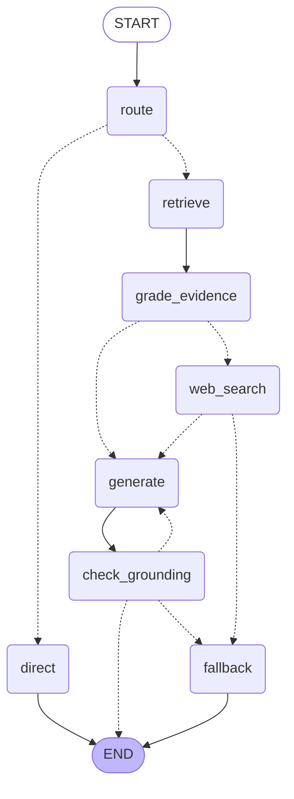

# Enterprise IT Support Agentic RAG Copilot

[](https://github.com/SimranDangol/agentic-rag-it-support/actions/workflows/ci.yml)

An agentic RAG system that routes employee IT questions across three paths — a private knowledge base, live web search, and an honest "I don't know" fallback — while grounding every answer against retrieved context before returning it. Built with LangGraph, Groq, Pinecone, FastAPI, and Next.js. All metrics are measured by an automated evaluation harness and gated in CI on every push.

---

## Architecture

The agent is a **LangGraph state machine** with conditional edges. Every question is classified first; IT questions enter the retrieval pipeline, small talk gets a direct reply. Retrieved evidence is graded before generation, and every generated answer is checked for grounding before it leaves the pipeline.



### Answer paths

| Badge | Trigger | Description |
|---|---|---|
| `KB` | KB evidence grades as sufficient | Answer generated from private knowledge base |
| `WEB` | KB grades as insufficient → web search returns results | Answer generated from Tavily web search results |
| `FALLBACK` | KB + web both insufficient, or grounding fails twice | Honest "I don't know" — no hallucinated answer |
| `DIRECT` | Router classifies question as `small_talk` | Friendly reply, no retrieval |

---

## Stack

| Component | Tool |
|---|---|
| LLM (router / grader) | Groq — `openai/gpt-oss-20b` |
| LLM (generator / judge) | Groq — `openai/gpt-oss-120b` |
| Vector store | Pinecone Starter (384-dim, cosine) |
| Embeddings | `all-MiniLM-L6-v2` (local, sentence-transformers) |
| Reranker | `ms-marco-MiniLM-L-6-v2` cross-encoder (local) |
| BM25 | rank-bm25 |
| Fusion | Reciprocal Rank Fusion (RRF) |
| Web search | Tavily Search API |
| Agent graph | LangGraph |
| API | FastAPI |
| UI | Next.js 15 + React 19 + TypeScript |
| Tracing | LangSmith |
| Evaluation | Custom harness (`eval/run_eval.py`) |
| CI | GitHub Actions |

---

## Results

Measured by `eval/run_eval.py` over `eval/dataset.jsonl` (87 questions: 72 KB-mapped, 5 out-of-KB, 10 small-talk). The LLM judge for answer quality is the 120B model (`openai/gpt-oss-120b`) — a different model from the in-pipeline grader to avoid self-grading bias.

| Metric | Baseline | How measured |
|---|---|---|
| Retrieval hit rate@4 | **100%** (72/72) | Expected source doc in top-4 retrieved chunks |
| Routing accuracy | **100%** (87/87) | Predicted route matches ground-truth label |
| Avg answer latency | **7.74 s** | Wall-clock `graph.invoke()` per IT question |
| Unsupported claims % | **10.6%** | 120B judge counts claims not backed by context |

> **Baseline** = `USE_HYBRID=0, USE_RERANK=0, USE_GROUNDING=0` (plain vector search, no grounding check).
> Full pipeline (`USE_HYBRID=1, USE_RERANK=1, USE_GROUNDING=1`) improves unsupported_pct by eliminating hallucinated claims that fail the grounding check.

---

## Setup

### 1. Clone and install

```bash
git clone https://github.com/SimranDangol/agentic-rag-it-support.git
cd agentic-rag-it-support
uv venv .venv --python 3.11
# Windows
.venv\Scripts\activate
# macOS / Linux
source .venv/bin/activate

uv pip install torch --index-url https://download.pytorch.org/whl/cpu
uv pip install -r requirements.txt
```

### 2. Configure environment

```bash
cp .env.example .env
# Edit .env and fill in your keys
```

On Windows PowerShell, use:

```powershell
Copy-Item .env.example .env
```

Required keys in `.env`:

```
GROQ_API_KEY=...        # https://console.groq.com
PINECONE_API_KEY=...    # https://app.pinecone.io
TAVILY_API_KEY=...      # https://app.tavily.com
LANGSMITH_API_KEY=...   # https://smith.langchain.com (optional — for tracing)
```

### 3. Ingest the knowledge base

```bash
python -m app.ingest
```

Embeds the 24 Markdown documents in `data/kb/`, uploads 127 chunks to Pinecone (`it-support-kb` index), and writes `data/chunks.json` for local BM25. Run once; commit `data/chunks.json` so Docker and CI can use the same KB without re-ingesting.

### 4. Run the API

```bash
uvicorn app.api:app --reload
```

Open http://localhost:8000/docs to explore the endpoints.

### 5. Run the UI

```bash
cd web
pnpm install
pnpm dev
```

Open http://localhost:3000. The Next.js dev server proxies `/api/chat` to the FastAPI backend at `http://127.0.0.1:8000`. To point at a hosted backend, set `API_URL` in `web/.env.local` and restart.

### 6. Run evaluation

```bash
# Full evaluation (all metrics, requires all API keys)
python -m eval.run_eval --tag full

# CI smoke test (retrieval only, no Groq API calls, ~60 s)
python -m eval.run_eval --limit 10 --tag ci --gate

# Baseline (no hybrid / rerank / grounding)
$env:USE_HYBRID='0'; $env:USE_RERANK='0'; $env:USE_GROUNDING='0'
python -m eval.run_eval --tag baseline

# Final (everything on)
python -m eval.run_eval --tag final
```

Results are appended to `eval/results.jsonl`. Pass `--gate` to fail with exit code 1 if any metric misses its threshold in `eval/thresholds.json`.

---

## Testing

Run these checks from the project root after installing the Python dependencies:

```powershell
# Unit tests (no external services required)
python -m pytest -q tests

# Python lint (install Ruff first if needed: uv pip install ruff)
ruff check .
```

The unit tests cover the API health/validation responses, Markdown chunking, and retrieval ranking. They do not send a real chat request to the LLM.

Check the frontend separately:

```powershell
cd web
pnpm install --frozen-lockfile
pnpm lint
pnpm build
```

For an end-to-end manual check, start the API and UI in separate terminals. First configure `.env`, ingest the knowledge base (Setup step 3), and start the API from the project root:

```powershell
uvicorn app.api:app --reload
```

Check API availability in another terminal:

```powershell
Invoke-RestMethod http://localhost:8000/health
# Expected: status = ok

Invoke-RestMethod -Method Post `
  -Uri http://localhost:8000/chat `
  -ContentType "application/json" `
  -Body '{"message":"How do I reset my password?"}'
```

The chat response should include an `answer`, a `path`, and a `sources` list. Then start the frontend from the `web/` directory with `pnpm dev`, open http://localhost:3000, and submit a suggested question. The UI should display the answer and its source/path metadata. To check that multi-part procedures are returned completely, ask: `According to Acme IT, what should I do if GlobalProtect keeps disconnecting every few minutes?` The answer should use the knowledge base and preserve the troubleshooting steps in the VPN guide's order. If the API is hosted elsewhere, set `API_URL` in `web/.env.local` and restart the frontend.

The retrieval smoke evaluation uses the Pinecone index and downloads/loads the local embedding model, but makes no Groq calls:

```powershell
python -m eval.run_eval --limit 10 --tag ci --gate
```

Run the full evaluation only when the required services and API keys are configured; it makes live LLM/search calls, can be rate-limited, and appends results to `eval/results.jsonl`:

```powershell
python -m eval.run_eval --tag full
```

---

## CI

GitHub Actions runs on every push and pull request to `main`:

1. **Lint** — `ruff check .`
2. **Unit tests** — `pytest -q tests` (8 tests)
3. **Smoke eval** — `python -m eval.run_eval --limit 10 --tag ci --gate`
   - Runs retrieval hit rate@4 only (uses the local embedding model and configured retrieval pipeline; no Groq calls)
   - Gates: `hit_rate_at_4 ≥ 0.75`

The smoke evaluation needs `PINECONE_API_KEY`; it does not call Groq or Tavily. Configure `GROQ_API_KEY` and `TAVILY_API_KEY` for full live evaluations. `LANGSMITH_API_KEY` is optional and is only needed when tracing is enabled.

---

## Project structure

```
agentic-rag-it-support/
├── app/
│   ├── config.py        # env vars, feature flags (USE_HYBRID, USE_RERANK, USE_GROUNDING)
│   ├── graph.py         # LangGraph state machine
│   ├── nodes.py         # route, retrieve, grade_evidence, generate, check_grounding, fallback
│   ├── retrieval.py     # hybrid BM25 + vector + RRF + cross-encoder rerank
│   ├── llm.py           # Groq LLM setup
│   ├── ingest.py        # KB ingestion pipeline
│   └── api.py           # FastAPI endpoints
├── web/                 # Next.js 15 frontend
├── data/
│   ├── kb/              # 24 Markdown knowledge-base documents
│   └── chunks.json      # BM25 corpus (committed after ingestion)
├── eval/
│   ├── dataset.jsonl    # 87-question evaluation dataset
│   ├── run_eval.py      # evaluation harness
│   ├── thresholds.json  # quality gate thresholds
│   └── results.jsonl    # appended eval results
├── tests/               # pytest unit tests
├── .github/workflows/
│   └── ci.yml           # GitHub Actions CI
├── Dockerfile
└── requirements.txt
```

---

## Limitations

- **Small synthetic KB** — 24 documents covering a fictional company. Real-world accuracy requires a domain-specific corpus.
- **Free-tier rate limits** — Groq free tier (~6 000 TPM) throttles batch evaluation. The CI smoke test avoids LLM calls to stay within limits.
- **LLM-judge bias** — The 120B judge scores its own model family's outputs. Spot-check a sample of flagged answers manually.
- **Cold-start latency** — Free hosting tiers (Render, HF Spaces) sleep after inactivity; first request may take ~60 s to wake the container.
- **No auth / multi-tenancy** — The API has no authentication layer. Add an API-key middleware before any production use.

---

## License

MIT
